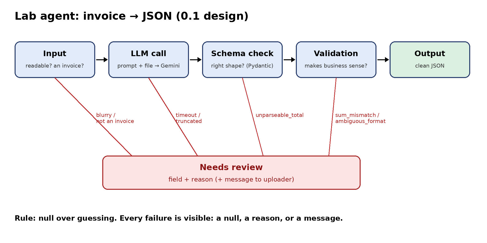

# lab-agent
Goal: An agent that turns an invoice into clean JSON, and returns null with a reason instead of guessing.

## Not in this repo
No employer code, documents, data or keys. Public samples only.

## Design

Editable diagram: [Excalidraw](https://excalidraw.com/#json=IhRdh3o8bd7DJOPGo0qGV,aiAkk2y0cyT8GGTgFJ-AKw)

### 0.1 failure table
| # | Stage | Failure | What the agent does instead of guessing |
|---|-------|---------|------------------------------------------|
| 1 | Input | Blurry or unreadable image | Stop before the LLM call. Needs review: `reason: unreadable`, message to uploader asking for a clearer copy |
| 2 | Input | Not an invoice (menu, random photo) | Stop. Needs review: `reason: not_an_invoice`, message to uploader |
| 3 | LLM call | Timeout or truncated response | Retry once, then Needs review: `reason: timeout` / `truncated`. Never use a partial answer |
| 4 | Schema check | Total can't be parsed as a number (e.g. "€4.500", missing) | `total: null`, `reason: unparseable_total` |
| 5 | Validation | Line items don't add up to the total | Keep the extracted values, flag `reason: sum_mismatch`, send to review |
| 6 | Validation | Ambiguous date or number format (03/04/2026) | `date: null`, `reason: ambiguous_format`, unless other evidence on the page settles it |

Rule: null over guessing. Every failure is visible: a null, a reason, or a message.

## Repo layout
- `notebooks/00_first_call.ipynb`: first Gemini call (invoice text → JSON). Outputs cleared, key read from Colab Secrets.
- `samples/public/`: 20 synthetic invoices from a public dataset (see `samples/SOURCES.md`).
- `samples/edge/`: 10 fictional edge cases mapped to the failure table above.

## Status
Phase 0: setup
